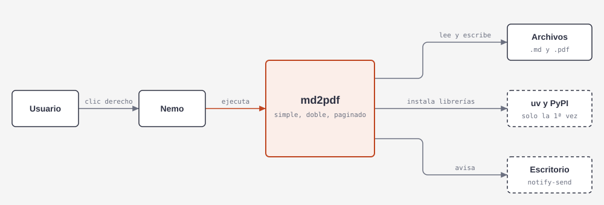

<div align="center">

# md2pdf

*Clic derecho en un archivo Markdown en Nemo y tenés un PDF listo para leer o imprimir.*


[Features](#features) • [Instalación](#instalación) • [Uso](#uso) • [Cómo funciona](#cómo-funciona)

</div>

md2pdf agrega un submenú **PDF** al menú contextual de Nemo para los archivos `.md` y `.markdown`. Elegís el formato y el PDF queda junto al original, con una notificación de escritorio al terminar.

Es para quien escribe notas, apuntes o documentación en Markdown y quiere pasarlos a papel o compartirlos.

## Features

- Tres formatos: simple, doble (dos columnas) y paginado (para imprimir).
- Salida en A4 con texto justificado y guionado, número de sección en el margen y fecha en la primera página.
- Los bloques de código llevan rótulo y resaltado en escala de grises. También admite tablas y diagramas SVG.
- El `.deb` suma las acciones de Nemo y arma el submenú del usuario. Las librerías de Python las baja `uv` la primera vez.

| Opción | Archivo de salida | Formato |
|---|---|---|
| PDF simple | `nombre.pdf` | A4, una columna |
| PDF doble | `nombre-doble.pdf` | A4, dos columnas justificado |
| PDF paginado | `nombre-paginado.pdf` | Simple, con dos páginas por cara para imprimir doble faz |

## Instalación

Requisitos: Linux con Nemo, [uv](https://docs.astral.sh/uv/), `fakeroot` y `dpkg-deb` para construir el paquete. El paquete depende de `libnotify-bin` y `poppler-utils`.

```bash
./build-deb.sh
sudo apt install ./dist/md2pdf_0.1.0_all.deb
nemo -q
```

> [!NOTE]
> El submenú de Nemo se arma por usuario. El instalador lo hace para quien corrió `sudo`; para otros usuarios ejecutá `md2pdf-menu`. Sin eso, las tres opciones aparecen sueltas en el menú.

## Uso

Desde Nemo: clic derecho sobre un `.md`, **PDF** y elegir la opción.

Desde la terminal:

```bash
md2pdf simple archivo.md      # archivo.pdf
md2pdf doble archivo.md       # archivo-doble.pdf
md2pdf paginado archivo.md    # archivo-paginado.pdf
```

El comando imprime la ruta del PDF generado. Con `MD2PDF_SILENCIO=1` no muestra la notificación de escritorio.

## Cómo funciona



Nemo ejecuta `md2pdf` con la opción elegida. El script lee el `.md`, genera el PDF con `src/md2pdf/pdf.py` (y `paginar.py` para el modo paginado) y lo escribe junto al original. La primera vez, `uv` instala las librerías de Python desde PyPI; al terminar se avisa con `notify-send`.

## Pruebas

```bash
tests/test.sh
```

Requiere `uv` y `poppler-utils`. El workflow de GitHub Actions corre las pruebas y arma el `.deb` en cada push.

## Actualizaciones con apt

Al instalar el `.deb` publicado, el paquete agrega el repositorio `https://ciromirkin.github.io/md2pdf` y su clave, así que `sudo apt update && sudo apt upgrade` trae las versiones nuevas.

Para actualizar solo este paquete: `sudo apt update && sudo apt install --only-upgrade md2pdf`. El `apt update` va primero porque `--only-upgrade` usa la lista de versiones que quedó de la última vez.

Para publicar una versión: `git tag v0.2.0 && git push --tags`. El workflow `release` arma el `.deb`, firma el repositorio y lo publica en GitHub Pages. Necesita los secretos `GPG_PRIVATE_KEY` y `GPG_KEY_ID` y Pages activado con origen "GitHub Actions".
